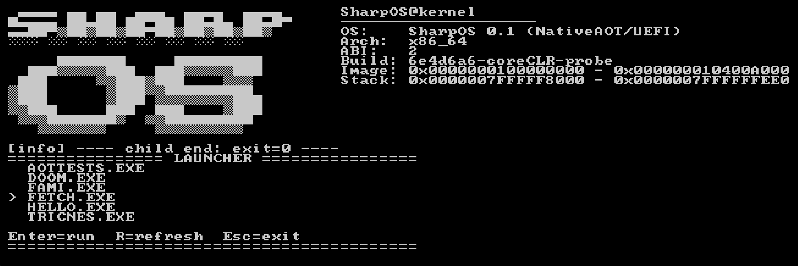
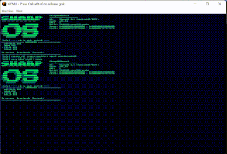
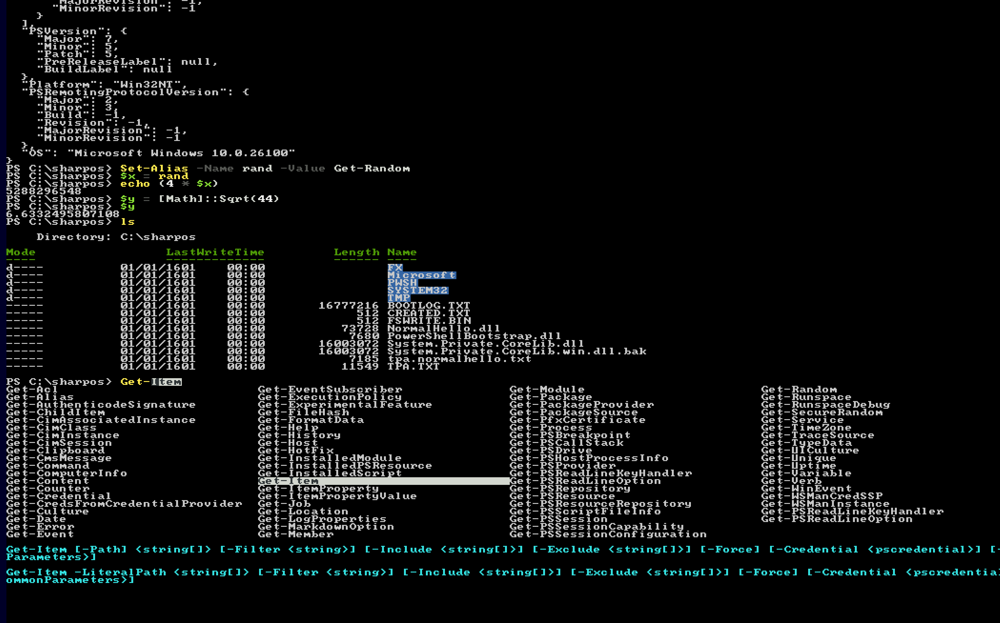

# SharpOS

Экспериментальная операционная система, целиком написанная на C#: загрузка, ядро, приложения и пользовательское окружение. Не на C# только [форк CoreCLR](https://github.com/daniilvaino/dotnet-runtime-sharpos/tree/sharpos/coreclr-port). Собирается обычным `dotnet publish -r win-x64`.

На SharpOS уже запускаются стоковый [**PowerShell 7.6.5**](#powershell) и играбельный [**DOOM**](#doom).

[](media/screenshot.png)

## Как запустить

### Через mise

Зависимости ставит mise по [`mise.toml`](mise.toml), так что начать нужно с него:

```bash
winget install jdx.mise        # Windows
brew install mise              # macOS
curl https://mise.run | sh     # Linux
```

Дальше репозиторий и зависимости:

```bash
git clone --recurse-submodules https://github.com/daniilvaino/SharpOS.git && cd SharpOS
mise trust && mise bootstrap   # Linux со старым индексом apt: mise bootstrap --update
```

Вход в среду сборки — дальше всё в PowerShell:

```bash
mise exec -- pwsh
```

Форк по желанию:

```powershell
git clone -b sharpos/coreclr-port https://github.com/daniilvaino/dotnet-runtime-sharpos.git
mise bootstrap                                                    # зависимости форка
cd dotnet-runtime-sharpos; ./build_clr_sharpos.ps1 -Clean; cd ..
```

Ядро, приложения и запуск:

```powershell
./build.ps1 launcher
$env:SHARPOS_GUI=1; ./run_build.ps1 -UsbOnly    # без форка добавить -SkipCoreClr
```

`run_build.ps1` собирает ядро, делает образ и запускает QEMU. `build.ps1` собирает приложения: без аргумента — все, `./build.ps1 list` покажет цели.

### Через nix

На NixOS и любом другом Linux с nix mise не нужен: инструменты даёт [`flake.nix`](flake.nix) двумя оболочками, версии закреплены в [`flake.lock`](flake.lock). Нужны включённые флейки (`nix-command flakes`).

```bash
git clone --recurse-submodules https://github.com/daniilvaino/SharpOS.git && cd SharpOS
```

Форк по желанию, в своей оболочке — его Arcade качает собственный SDK, поэтому ей нужен FHS. Первый вход требует splat MSVC; команду печатает сама оболочка, делается один раз:

```powershell
git clone -b sharpos/coreclr-port https://github.com/daniilvaino/dotnet-runtime-sharpos.git
nix run .#fork -- -c pwsh                       # оболочка форка, сразу в PowerShell
xwin --accept-license --cache-dir .xwin-cache --manifest-version 17 `
     --sdk-version 10.0.26100 --crt-version 14.44.17.14 --arch x86_64 `
     splat --preserve-ms-arch-notation --include-debug-libs --output .xwin-cache/splat
cd dotnet-runtime-sharpos; ./build_clr_sharpos.ps1 -Clean; cd ..
```

Ядро, приложения и запуск — во второй оболочке:

```powershell
nix develop --command pwsh
./build.ps1 launcher
$env:SHARPOS_GUI=1; ./run_build.ps1 -UsbOnly    # без форка добавить -SkipCoreClr
```

`run_build.ps1` собирает ядро, делает образ и запускает QEMU (прошивку UEFI даёт он же). `build.ps1` собирает приложения: без аргумента — все, `./build.ps1 list` покажет цели. Первый заход тянет из кеша около 4.6 GiB для оболочки ядра и 2.6 GiB для оболочки форка.

### Payloads

DOOM1.WAD, картриджи `.nes` и PowerShell для самой SharpOS кладутся в [`payloads/`](payloads/README.md).

### Логи

Ядро (COM1) — `last_build.log`, программы (COM3) — `last_app.log`, их ошибки (COM4) — `last_err.log`.

## Архитектурные инварианты

### 1. Весь исходный код на C#

В дереве нет ни одного файла `.c`, `.cpp`, `.h`, `.asm` или `.s`. MSBuild и PowerShell только оркестрируют сборку, логики системы в них нет. Всё низкоуровневое (обработчики прерываний, сохранение callee-saved регистров, write barrier'ы, трамплины interface dispatch) делается одним из трёх способов:

1. **Средства самого C#:** `[RuntimeExport]`, `[UnmanagedCallersOnly]`, `delegate* unmanaged`, `fixed`, арифметика указателей.
2. **Машинный код из C#.** Ассемблер [Iced](https://github.com/icedland/iced) пишет его в исполняемый буфер:
   - *При сборке* source generator `BootAsm.Generator` заранее превращает 16 стабов раннего старта (interface dispatch, трамплины IDT, EH-фанклеты, GC stack spill, порты ввода-вывода) в байтовые шаблоны. При загрузке они копируются в буфер, и в них подставляются адреса managed-колбэков.
   - *В рантайме*, когда куча, GC и исключения уже работают, Iced вызывается напрямую: `new Assembler(64); a.mov(rax, rcx); a.Assemble(writer, rip);`.
3. **Нативные символы данных из атрибута.** Если линкеру нужен символ, который ILC не эмитит (например, `__security_cookie`), MSBuild-задача `CoffStub.Generator` находит атрибут в коде и сама создаёт `.obj`:

   ```csharp
   [BootAsm.CoffDataSymbol("__security_cookie", Section = ".data", Alignment = 8)]
   public static ulong SecurityCookie = 0x2B992DDFA232UL;
   ```

   Через ту же задачу приложения из `apps_native/` собираются как freestanding win-x64 PE.

Любая новая низкоуровневая задача решается одним из этих способов. Если кажется, что не решается, значит, она неверно поставлена. Так уже сделаны GC stack spill, чтение и запись CR3, interface dispatch с резолвером для shared generics, инициализация модулей NativeAOT без линкерных сентинелов.

Насколько нам известно, других ОС с таким инвариантом нет.

### 2. Имена из .NET только для совместимых реализаций

Реализация получает каноническое имя в `System.*` или `System.Collections.Generic.*`, только если полностью соблюдает публичный контракт BCL (с оговорками из [`docs/nativeaot-nostd-kernel-limits.md`](docs/nativeaot-nostd-kernel-limits.md)). Частичные и нестандартные живут в своих пространствах имён: `SharpOS.Std.*`, `OS.Kernel.*`. Так LINQ и другой код BCL со временем можно будет брать из dotnet/runtime как есть.

## Три яруса исполнения

| Ярус | Что на нём работает | Где лежит | Чем собирается |
|---|---|---|---|
| **Kernel-AOT** | ядро, загрузка, драйверы, планировщик | `OS/` | NativeAOT + NoStdLib + свой MinimalRuntime |
| **PE-app** | приложения: `LAUNCHER.EXE`, `AOTTESTS.EXE`, `DOOM.EXE` и другие | `apps_native/` | NativeAOT + NoStdLib + общий SDK из `apps_native/sdk/` |
| **CoreCLR-hosted** | стоковые .NET DLL байт-в-байт | `\sharpos\*.dll` на FAT | форк CoreCLR, статически слинкованный с ядром |

Ограничения описаны в двух документах: [`docs/nativeaot-nostd-kernel-limits.md`](docs/nativeaot-nostd-kernel-limits.md) для первых двух ярусов (std у них общая) и [`docs/coreclr-hosted-limits.md`](docs/coreclr-hosted-limits.md) для третьего.

## Что работает

- ✅ работает, подтверждено прогоном: пробы в [`OS/src/Kernel/Diagnostics/`](OS/src/Kernel/Diagnostics/), гейт в [`tools/probe_report.ps1`](tools/probe_report.ps1)
- 🟡 частично
- ⏳ запланировано, см. [`plan.md`](plan.md)
- 🔴 пока нет или сломано, но достижимо
- 🚫 невозможно или неприменимо по архитектуре

### Язык и рантайм

| Возможность | Kernel-AOT | PE-app | CoreCLR-hosted | Комментарий |
|---|:-:|:-:|:-:|---|
| `new T()`, управляемая куча | ✅ | ✅ | ✅ | |
| `string`, примитивы, структуры | ✅ | ✅ | ✅ | |
| Boxing / unboxing | ✅ | ✅ | ✅ | |
| `try` / `catch` / `finally` / `throw;` / фильтры `when` | ✅ | ✅ | ✅ | |
| Аппаратный сбой → managed-исключение (`#PF` → `NullReferenceException`) | 🟡 | 🟡 | ✅ | в приложении исключение типа самого приложения, его ловит `catch (Exception)`; необработанное исключение главного потока завершает приложение с кодом 134, а не машину; `#UD` не превращается в исключение, необработанное в рабочем потоке приложения — `Panic` |
| `Exception.StackTrace` | 🟡 | 🟡 | 🔴 | AOT: текст с адресом, базой образа и смещением; имён методов пока нет. Hosted: `null` для любого исключения — рантайм не записывает кадров вовсе |
| Исключение в статическом конструкторе → `TypeInitializationException` | ✅ | ✅ | 🟡 | в hosted пробрасывается как есть, без обёртки |
| `[ModuleInitializer]` | 🔴 | ⏳ | ✅ | атрибут в std есть, но инициализатор не вызывается |
| `yield return` | ✅ | ✅ | ✅ | |
| `async` / `await` | ✅ | ✅ | ✅ | в std без захвата контекста синхронизации |
| Делегаты и лямбды | ✅ | ✅ | ✅ | в std порт из dotnet/runtime без рефлексии, GVM, open-instance и вариантных приведений |
| Generic sharing (`__Canon`) | ✅ | ✅ | ✅ | |
| Виртуальные вызовы и interface dispatch | ✅ | ✅ | ✅ | |
| Generic `as T` / `(T)x` с `where T : class` | 🟡 | 🟡 | ✅ | в AOT не работает вариантное приведение к интерфейсу |
| Ковариантность массивов (`stelem.ref`) | 🟡 | 🟡 | ✅ | в AOT проверок нет: запись чужого типа даёт тихое UB вместо `ArrayTypeMismatchException` |
| Многомерные массивы (`int[,]`) | 🟡 | 🟡 | ✅ | без ненулевых нижних границ и `int[*]` |
| `typeof(T)` / `System.Type` | 🔴 | 🟡 | ✅ | в приложениях только сравнение через `==`: ни `Name`, ни членов |
| `record`, `init`-аксессоры | 🔴 | ✅ | ✅ | записям нужен `typeof`, а в ядре его нет |
| Рефлексия: `System.Reflection`, `Activator.CreateInstance(Type)`, `Type.GetType(string)` | 🔴 | 🔴 | ✅ | в AOT нет метаданных |
| `dynamic` | 🔴 | 🟡 | ✅ | AOT: свой связыватель без DLR, переходники и таблицы членов пишет генератор (step193); нет вывода типов обобщённых методов, событий, `ref`/`out` и именованных аргументов; в ядре не гонялось |
| `Reflection.Emit`, DLR, `Expression<T>.Compile()` | 🚫 | 🚫 | ✅ | нужен JIT |
| `AssemblyLoadContext` (несколько ALC) | 🚫 | 🚫 | ⏳ | нужен JIT |

### Сборка мусора

| Возможность | Kernel-AOT | PE-app | CoreCLR-hosted | Комментарий |
|---|:-:|:-:|:-:|---|
| GC (mark-sweep, точное сканирование стека) | ✅ | ✅ | ✅ | hosted: свой GC через PAL; у каждого PE-приложения свой сборщик и своя куча |
| `GC.Collect` | ✅ | ✅ | ✅ | `GC.WaitForPendingFinalizers`, вероятно, зависает (не перепроверяли) |
| Write barrier (`RhpAssignRef`, `RhpStelemRef`) | ✅ | ✅ | ✅ | в AOT пустышка: сборщик без поколений |
| `WeakReference` / `GCHandle` | 🔴 | 🔴 | ✅ | в наших сборщиках нет слабых дескрипторов |
| `ConditionalWeakTable<K,V>` | 🔴 | 🟡 | ✅ | ссылки сильные: запись живёт, пока жива таблица |

### Стандартная библиотека

| Возможность | Kernel-AOT | PE-app | CoreCLR-hosted | Комментарий |
|---|:-:|:-:|:-:|---|
| Коллекции (`List<T>`, `Dictionary<K,V>` и т. д.) | ✅ | ✅ | ✅ | порты из BCL |
| `SortedDictionary` | 🟡 | 🟡 | ✅ | внутри сортированный массив: вставка линейная |
| LINQ | ✅ | ✅ | ✅ | своя мини-реализация `System.Linq.Enumerable` |
| `string.Format`, интерполяция, `ToString(format)` чисел | 🟡 | 🟡 | ✅ | форматтер чисел и `DefaultInterpolatedStringHandler` из .NET 8 (UTF-16 и UTF-8); культура только инвариантная, без `decimal`/`Half`/`Int128` |
| `System.Enum` | 🟡 | 🟡 | ✅ | нет `ToString`, `GetNames`; `ToObject` есть, `Parse` — только числом: имён членов без метаданных нет |
| `Enum.IsDefined` | 🔴 | 🟡 | ✅ | в приложениях всегда `true`: метаданных перечислений нет |
| `DateTime` / `TimeSpan` | 🟡 | 🟡 | ✅ | порт BCL (step212): `DateTime`, `DateTimeOffset`, `TimeSpan`, `DateOnly`, `TimeOnly`, все стандартные и пользовательские форматы, инвариантная культура; `TimeZoneInfo` только с UTC — базы поясов нет, `Local` = UTC. Часы — нет. В ядре источник не подключён, `Now` = начало эпохи (`IsRealClock` = false). В приложениях с step182 идут монотонные часы от HPET: интервалы верны, дата нет (эпоха + аптайм). Настоящую дату отдаёт только hosted-ярус |
| `Array.Copy` с перекрытием (семантика memmove) | ✅ | ✅ | ✅ | |
| `Math.Abs`, `Math.Sqrt` | ✅ | ✅ | ✅ | |
| `Math.Floor` / `Ceiling` / `Truncate` / `Round` | ✅ | ✅ | ✅ | |
| `Math` / `MathF`: тригонометрия, exp/log, `Pow`, гиперболические, `Cbrt`, `FusedMultiplyAdd` | ✅ | ✅ | 🟡 | в AOT — SharpLibm, правильно округлено (проверено на худших случаях CORE-MATH против MPFR, float — на всех 2³² входах); hosted — libm форка, ~1e-9 |
| `Vector128<T>` (SSE) | ✅ | ✅ | ✅ | `Vector256` объявлен, но не ускорен |
| Разбор XML | ✅ | ⏳ | ✅ | TurboXml; ядро читает им манифесты приложений |
| JSON: `Utf8JsonReader` / `Utf8JsonWriter`, `JsonDocument`, `JsonNode` | ⏳ | 🟡 | ✅ | из System.Text.Json (.NET 10): чтение кусками, запись в `IBufferWriter<byte>`. Сериализатора и `JavaScriptEncoder` нет |
| Разбор чисел (`Parse` / `TryParse`) | 🟡 | 🟡 | ✅ | `double`, `float`, `decimal` — как в BCL; `int` и `long` — только `Parse(string)` и `TryParse`; остальных целых нет |
| Разбор `DateTime` / `TimeSpan` / `Guid` | 🟡 | 🟡 | ✅ | `Parse`/`ParseExact`/`TryParse*` — порт BCL (step212); инвариантная культура, поясов кроме UTC нет |
| Base64 и hex через `Convert` | 🟡 | 🟡 | ✅ | `Convert.From/ToBase64String`, `From/ToHexString` над `System.Buffers.Text.Base64` и `HexConverter` (step212); прогоном не проверены, перенос строк Base64 не портирован |
| Разбор `.env` | ✅ | ✅ | 🚫 | формат `env_file` Docker Compose, проверен тестами compose-go; ядро читает им `/config/system.env` |
| Коллекции `Concurrent.*` и `Immutable.*`, `SortedSet`, `BitArray`, `KeyedCollection`, `Array.BinarySearch`, `Regex`, `ValueTuple` | 🔴 | 🔴 | ✅ | пока не портированы; `Tuple<T1,T2>` есть |
| CBOR (`System.Formats.Cbor`) | 🔴 | ✅ | ✅ | порт из dotnet/runtime; без `Half`, `BigInteger`, `decimal` и `DateTimeOffset` — теги при этом читаются. Разбор проверен на ответе аппаратного ключа, запись пока нет |
| `System.Uri` | 🟡 | 🟡 | ✅ | порт System.Private.Uri (.NET 10, step212) вместе с `SearchValues`, `IdnMapping` (инвариантный режим) и `Hashtable`; std считает себя Unix-платформой (`OperatingSystem.IsWindows()` = false), `file:///home/x` — путь `/home/x`; прогоном не проверен |
| `RandomNumberGenerator` | 🟡 | ✅ | ✅ | порт BCL поверх `RDRAND` (step212): ядро — `HardwareRandom`, приложения — служба ядра; процессор без `RDRAND` — `CryptographicException`, а не предсказуемые байты (в QEMU нужен `-cpu …,+rdrand`, `run_build` ставит). В ядре прогоном не проверен |
| SHA-256 | ✅ | ✅ | ✅ | `System.Security.Cryptography.SHA256.HashData`, своя реализация в std. Других алгоритмов нет: ни P-256, ни AES, ни HMAC |

### Потоки и синхронизация

| Возможность | Kernel-AOT | PE-app | CoreCLR-hosted | Комментарий |
|---|:-:|:-:|:-:|---|
| `Thread.Start()` | ✅ | 🟡 | ✅ | в приложениях вместо `Thread` есть `AppThreads.Spawn` и `Task.Run` |
| `Task.Run`, `Task.Delay` | ✅ | ✅ | ✅ | на пуле потоков; потоки приложения умирают вместе с ним |
| `ContinueWith`, `WhenAny`/`WhenAll`, `WaitAsync`, `TaskCompletionSource(options)` | 🟡 | 🟡 | ✅ | step212: продолжения в `Task` std, синхронные или на пул; `TaskScheduler` — только `Default` (пул); одно исключение вместо `AggregateException`; прямыми тестами не покрыты |
| `ThreadPool.QueueUserWorkItem` | ⏳ | ⏳ | ✅ | |
| `lock` (`Monitor.Enter` / `Exit`) | ✅ | ✅ | ✅ | `Pulse` / `Wait` намеренно не реализованы |
| `[ThreadStatic]` | 🟡 | 🟡 | ✅ | с step209; каждое обращение — вызов, а не встроенный TLS; изнутри разделяемого обобщённого кода (через словарь) — исключение. В ядре — после `Scheduler.Init` |
| `Interlocked.CompareExchange` | ✅ | 🟡 | ✅ | в std это заглушка без `LOCK`, верна только для одного потока; ядро вызывает настоящий `LOCK CMPXCHG` напрямую |
| `Event` / `Semaphore` / `Mutex` | ✅ | ⏳ | ✅ | |
| Кооперативные `Yield()` / `Sleep(ms)` | ✅ | ✅ | ✅ | в приложениях через `AppThreads.Sleep` |
| Многопоточные процессы | ✅ | ✅ | ✅ | |
| Вытеснение потоков | 🟡 | 🟡 | 🟡 | под лаунчером включено для ядра и приложений: один процессор, критические секции `Preemption.Suppress`; проверено только под QEMU. В hosted вытесняется и JIT-код |
| SMP | ⏳ | ⏳ | ⏳ | |

### Железо и ввод-вывод

| Возможность | Kernel-AOT | PE-app | CoreCLR-hosted | Комментарий |
|---|:-:|:-:|:-:|---|
| Прямой доступ к железу (CR3, PCI, MMIO, IDT) | ✅ | 🚫 | 🚫 | |
| Ассемблер x64 на Iced (при сборке и в рантайме) | ✅ | 🚫 | 🚫 | пока без EVEX |
| Свои аппаратные прерывания (local APIC, тик 1000 Гц, MSI) | 🟡 | 🚫 | 🚫 | диск AHCI и xHCI — на MSI/MSI-X, драйвер спит до прерывания (step210); устройства без MSI опрашиваются, IO-APIC не поднят |
| Выключение и сброс | 🟡 | 🚫 | 🚫 | свои: ACPI S5 по FADT и `\_S5_` из DSDT (без интерпретатора AML), затем сброс через 0xCF9 и 0x64; UEFI `ResetSystem` — последним (step210). Перезагрузки как отдельной команды нет |
| AVX / AVX-512 | 🟡 | 🟡 | 🔴 | на процессорах с AVX состояние включено в XCR0 и сохраняется прерываниями (XSAVE); из AVX используется только FMA в libm — компилятор собирает под SSE. CoreCLR на SSE. AVX-512 нет |
| USB (xHCI) | 🟡 | 🟡 | 🚫 | свой стек, проверен на железе: составные устройства, несколько HID-интерфейсов на одном, клавиатура, флешки (BOT + SCSI), CDC-ACM, аппаратный ключ по CTAPHID (регистрация U2F с подтверждением присутствия). Приложениям шина видна двумя службами (`UsbEnumerate`, `UsbCtap`) — дерево и обмен с ключом. На прерываниях MSI/MSI-X (step210). Без хабов, мыши и **горячего подключения**: шина перечисляется один раз при загрузке |
| Чтение файлов | ✅ | ✅ | ✅ | свой FAT, работает и после ExitBootServices |
| Запись файлов | 🟡 | 🟡 | 🔴 | FAT32: файлы и каталоги создаются, удаляются, переименовываются и переносятся; файл пишется где угодно (`Seek`, `SetLength`, запись в середину); каталог растёт; имена в UTF-8 (кириллица, символы вне BMP), регистр 8.3 сохраняется; счётчик свободного места ведётся (FSInfo), кэш устройства сбрасывается при закрытии файла и перед выключением; кэш секторов. Приложениям — `FileStream`, `File.*`, `Directory.*`, `FileInfo`/`DirectoryInfo`, `DriveInfo`, `File.Copy`/`Move`; в оболочке `mkdir`, `rm`, `rmdir`, `mv`, `cp`, `ls -l`, `df`. Каждый прогон проверяется снаружи `fsck.fat`. Жёлтое: PowerShell (PAL) каталоги не создаёт и файлы не удаляет; на железе стенда новое не гонялось |
| Сеть | 🔴 | 🔴 | 🔴 | нет драйвера сетевой карты |
| Ввод с клавиатуры в консоли | ✅ | ✅ | ✅ | |

### Приложения и процессы

| Возможность | Kernel-AOT | PE-app | CoreCLR-hosted | Комментарий |
|---|:-:|:-:|:-:|---|
| Код возврата процесса | ✅ | ✅ | ⏳ | |
| Несколько приложений сразу (процессы) | 🟡 | 🟡 | 🚫 | `Process.Start`/`WaitForExit`/`Kill`, до 16, каждое в своём диапазоне адресов; куча растёт по мере надобности, переполнение стека — выход 134; один процессор, старт + выход ≈10 мс на ноутбуке |
| Родные трубы: объекты между ядром и приложениями | 🟡 | 🟡 | 🚫 | `PipeWriter<T>`/`PipeReader<T>`/`Region<T>`, типы `[Message]`; копия, `Move`, чтение на месте, чтение по описанию; между приложениями по имени и концами при старте (стандартные вход и выход); без выделений на сообщение, между процессами вровень с `BinaryWriter` по каналу ОС на одном ядре; байты и текст (`Pipe.ReadBytes`/`WriteBytes`/`ReadText`/`WriteText`); конвейер из кода — `Pipe.From`/`Pipe.To`; принятый Expando правится на месте (`ExpandoEdits`: в запасе блока без выделений, иначе рост или сжатие); проверено только под QEMU |
| Внешние данные: `READ`, `WRITE`, `CONVERT` | 🚫 | 🟡 | 🚫 | файл в трубу и обратно; `> файл` хранит поток объектов как есть (externalpipe), `READ` отдаёт те же сообщения без класса; JSON, JSON Lines, CBOR, CBOR Sequence и строки в объекты (`Expando`) и обратно, `Into<T>` из `Expando`; потоково, память — один элемент; проверено только под QEMU |
| Запросы KQL в конвейере | 🚫 | 🟡 | 🚫 | `PIPEGEN 100 \| KQL 'where Level >= 3 \| summarize n = count() by Level'`: сообщения входа — таблица, читается по мере прихода; `take` прекращает чтение, `where`/`take`/`sort` пересылают исходные блоки, `extend` пишет в само сообщение (над Expando — любые скаляры, над типом с полями — числа, bool, даты, интервалы и строки в существующие поля), `project`/`project-away`/`project-rename` над Expando — правки самого блока; схема — из объявления писателя, запрос связан до данных; Expando — открытая таблица, каждое имя — свой столбец `dynamic`; Expando и вложенные объекты — `dynamic` (поля, сравнения, арифметика, `tostring`/`tolong`); ошибки запроса с позицией; `… \| KQL` без запроса спрашивает его, когда тип входа известен, Tab дополняет по его столбцам; без `matches regex`, `extract()`, `url_decode`/`url_encode_component`; проверено только под QEMU |
| Terminal.Gui | 🚫 | ✅ | ⏳ | на нашей std, свой драйвер поверх терминала ядра; мыши нет |
| Скрипты: Lua и JavaScript | 🚫 | 🟡 | 🚫 | `LUA` (Lua-CSharp, Lua 5.2) и `JS` (Okojo, ECMAScript): `-e`, файл, приглашение; стадия конвейера — сообщение входит таблицей или объектом, выходит Expando или строкой (step212). У Lua `require` по `/bin/lua` и текущему каталогу, `init.lua`; у JS нет `require`/`import` и API Node и браузера; проверено только под QEMU |
| Оболочка с синтаксисом bash | 🚫 | 🟡 | 🚫 | `&&` `\|\|` `;`, конвейер `a \| b \| c`, встроенные `cd` `pwd` `ls` `cat` `echo` `expect` `exit` `export` `unset` `env` `which`, `$ИМЯ` и `${ИМЯ}` из окружения, программы по `PATH`, запуск `.EXE` (с аргументами) и `.DLL` (без); `> файл` и `>> файл` в конце конвейера, код конвейера — первой упавшей стадии; `<` нет; переменных оболочки, `$(…)`, циклов и `if` нет — строка с ними отклоняется целиком, с номером столбца. Редактор строки (ReadLine): история между сеансами, Tab (и по `$ИМЯ`, и внутри `KQL '…'`), Ctrl-клавиши, `clear`. Ctrl+C прерывает только набор строки, не запущенную программу |
| Изоляция процессов через MMU | 🚫 | 🚫 | 🚫 | это unikernel |
| Параллельное исполнение по одному виртуальному адресу | 🚫 | 🚫 | 🟡 | потоки в одном ALC работают, несколько ALC в планах |

Всё, что сломано, виснет или ждёт доработки, собрано в [`limits.md`](limits.md).

## Трубы

Программы в SharpOS передают друг другу объекты, а не байты. `PIPEGEN | PIPEFILT 3 | PIPECNT` в оболочке работает так же, как в bash. Но каждая стадия получает настоящий объект с полями: его не нужно разбирать из текста, и в кучу получателя он не копируется. Объект лежит в общей памяти обмена, и следующая стадия читает его прямо там.

### В оболочке

```sh
PIPEGEN 10                                   # десять LogEntry на экран
PIPEGEN 1000 | PIPEFILT 3 | PIPECNT          # фильтр со своим классом, счётчик без класса
PIPEGEN 100 | KQL 'where Level >= 3 | summarize n = count() by Level'
PIPEGEN 100 | KQL                            # kql (LogEntry)> запрос, Tab — столбцы LogEntry
SYNTH 20 | VIEWFILT 3                        # тип, которого нет ни в одной программе
PIPEGEN 1000 | PIPESPY a | PIPESPY b | PIPECNT   # обе стадии видят объект по одному адресу
PIPEGEN 20 | LUA -e "return function(m) m.Square = m.Level * m.Level return m end" | JS -e "m => ({...m, Even: m.Level % 2 == 0})" | KQL 'where tobool(Even)'
SYSINFO 3>&- | KQL 'project-away Storage, Input' | LUA -e "return strings" | CONVERT --to jsonl | JSON2DIR   # числа и bool строками: json2dir берёт только строки
```

`PIPESPY` печатает адрес, по которому пришло сообщение. Две такие стадии подряд показывают один и тот же адрес: это один объект проходит через четыре программы.

Код конвейера — код первой слева стадии, которая завершилась не с 0 и не с 141. 141 означает тихий выход: следующая стадия закрыла свой вход раньше, например `KQL '… | take 5'`. Если стадия упала посреди потока, её выход обрывается. Сосед видит сбой, а не обычный конец данных, и не примет половину ответа за целый.

### Файлы

`> файл` сохраняет поток таким, каким он шёл по трубе, а `READ` отдаёт его обратно теми же сообщениями. Класс для этого не нужен ни при записи, ни при чтении.

```sh
PIPEGEN 100 > log.pipe
READ log.pipe | KQL 'where Level > 2'        # запрос связывается до первого сообщения, как над живым писателем
PIPEGEN 10 >> log.pipe                       # дописать можно только тот же тип
SYNTH 5 >> log.pipe                          # другой тип: отказ, файл не меняется
```

Формат файла называется `externalpipe`: описание типов трубы один раз и затем сами блоки сообщений. Поток строк и `byte[]` пишется в файл обычными байтами, без заголовка. Текст, JSON и CBOR — явные преобразования через `CONVERT`:

| `CONVERT --to X` / `--from X` | что это |
|---|---|
| `json` | один массив, объект на строку. `--from json` сам определяет, массив на входе или JSON Lines |
| `jsonl` | JSON Lines, по объекту на строку |
| `cbor` | документ CBOR: тег 55799 и массив. `--from cbor` принимает и последовательность |
| `cborseq` | CBOR Sequence (RFC 8742) |
| `lines` | строка как на экране / строка на строку файла |
| `externalpipe` | то же, что делают `>` и `READ`, отдельной стадией |

```sh
PIPEGEN 5 | CONVERT --to json > log.json
READ log.json | CONVERT --from json | KQL 'where Level == 4'
READ log.pipe | CONVERT --to cbor > log.cbor          # читается на хосте: python -c "import cbor2; ..."
READ data.bin --bytes                                 # любой файл как сырые байты
READ log.pipe --externalpipe                          # только сообщения: не externalpipe — отказ (1)
```

Без ключа `READ` смотрит на начало файла: externalpipe отдаёт сообщениями, остальное — байтами. `--bytes` и `--externalpipe` говорят это явно.

Всё потоковое: в памяти держится одно сообщение, так что файл на 100 МиБ проходит через кучу в 64 МиБ. Из JSON и CBOR получаются `Expando`. У CBOR, в отличие от JSON, после обратного чтения остаются `byte[]`, `DateTime`, `Guid` и разница между `float` и `double`.

### Из C#

Тип, который может ходить по трубе, помечается `[Message]`. Генератор вносит его в каталог образа: имя, поля, смещения.

```csharp
[Message]
public sealed class LogEntry
{
    public int Level;
    public string Text;
}
```

Писатель и читатель:

```csharp
using var output = Pipe.Write<LogEntry>();               // стандартный выход (без него — экран)
for (int i = 0; i < n; i++)
    output.Copy(new LogEntry { Level = i % 5, Text = "text " + i });

foreach (LogEntry e in Pipe.Read<LogEntry>())            // объект прочитан на месте, живёт до следующего шага
    Console.WriteLine(e.Text);
```

Стадия-фильтр — одна строка. Подошедшие блоки уходят дальше как пришли, без копии:

```csharp
Pipe.Read<LogEntry>().Where(e => e.Level >= min).WriteTo();
```

Класс не обязателен. Через вид (`View`) можно читать любое сообщение по описанию, которое прислал писатель:

```csharp
Pipe.Read().Where(v => v["Level"] >= min).WriteTo();    // VIEWFILT: работает и с SYNTH, и с Expando из JSON
foreach (View v in Pipe.Read()) n++;                     // PIPECNT
```

`Expando` — объект без класса, словарь имён в порядке добавления. Ходит по трубе как любой `[Message]`:

```csharp
var e = new Expando();
e["Level"] = 3;
e["When"] = DateTime.Now;
Pipe.Write<Expando>().Copy(e);
```

Принятое сообщение можно править на месте, не собирая заново:

```csharp
Pipe.Read().Edit(r =>
{
    r.Set(r.Root, "Seen", true);      // новое поле в Expando — в запас блока, без выделений
    return true;                      // false — выбросить сообщение
}).WriteTo();
```

Сообщение без класса раскладывается в свой класс по именам полей. Числа при этом сужаются с проверкой, строка становится перечислением, `DateTime`, `TimeSpan` и `Guid` разбираются из строк:

```csharp
foreach (LogEntry e in Pipe.From("READ log.json | CONVERT --from json").Into<LogEntry>()) …
```

`Pipe.From` и `Pipe.To` запускают конвейер из кода той же строкой, что в оболочке. Если какая-то стадия падает, вызывающий получает `PipelineException` с её именем и кодом:

```csharp
Pipe.Read("myapp.log").WriteTo(Pipe.To("CONVERT --to json | WRITE errors.json"));
```

Кроме стандартных входа и выхода есть трубы по имени: `Pipe.Write<T>("name")` и `Pipe.Read("name")`. `Region<T>` и `Move` передают блок дальше без копии; это низкий уровень, его используют `WriteTo` и KQL.

### Как это устроено

- **Сообщение — один блок в арене обмена.** Это граф объектов с корнем. Ссылки внутри блока — смещения от его начала, поэтому блок не зависит от адреса: его можно переложить, отдать другому процессу или записать в файл.
- **Тип объекта задаётся ключом,** а не указателем на таблицу методов. Ключ — хеш имени и раскладки: два образа согласны о типе ровно тогда, когда совпадают и имя, и поля, и смещения.
- **Описание типов идёт по трубе один раз,** при объявлении писателя, а не в каждом сообщении. По нему печатают и фильтруют программы, у которых класса нет. По нему же KQL связывает запрос ещё до первых данных.
- **Читатель проверяет блок при обращении.** Запись, до которой дошёл вид, должна лежать внутри блока, иметь известный ключ и помещаться целиком. Чужой или битый блок отказывает там, где его читают. Проход по всему блоку делает только правка на месте, один раз.
- **Ноль выделений на сообщение** на всех путях: копия, пересылка, чтение на месте. Между двумя процессами (step208, под QEMU) — вровень с `BinaryWriter` по каналу Linux на одном ядре: маленькое сообщение 0,28 мкс против 0,27–0,36, объект с массивом из 100 — 5,9 мкс против 7,6–9,7, граф из 30 000 объектов — 1,5 мс против 2,1–2,2.

Подробнее: [`pipe_plan.md`](pipe_plan.md), разборы шагов `done/step189.md`–`done/step206.md`.

### Чего пока нет

- `<` в оболочке. Вместо `prog < файл` пиши `READ файл | prog`.
- Из CBOR и JSON получаются только `Expando`, типизированных сообщений по описанию из них не собрать.
- Читатель с классом принимает только ту же раскладку. Для другой версии класса нужен вид или `Into<T>`.

## Раскладка образа

| папка | что там |
|---|---|
| `/EFI/BOOT` | `BOOTX64.EFI` — ядро |
| `/bin` | программы: оболочка, лаунчер, `READ`, `WRITE`, `CONVERT`, `KQL`, демо-стадии труб |
| `/games` | игры вместе с данными: DOOM и WAD, эмуляторы NES и картридж |
| `/tests` | батарея и её данные |
| `/config` | `system.env` — что запускать после загрузки и окружение для всего, что запускает ядро; сценарий батареи |
| `/home` | рабочая папка по умолчанию |
| `/system` | для системы помимо ядра, пока пусто |
| `/sharpos` | рантайм CoreCLR, PowerShell |

`system.env` — строки `ИМЯ=значение`: `PATH=/bin;/tests;/games`, `HOME=/home`, `INIT=/bin/LAUNCHER.EXE`. Программа ищется по `PATH`, а куда она ляжет, задаёт `<SharpOsCategory>` в её `.csproj`. Лаунчер открывается на вкладке «Главная»: плитки оболочки, PowerShell и игр.

В оболочке окружение меняют `export ИМЯ=значение` и `unset ИМЯ`, `env` его печатает, `env ИМЯ=значение программа` запускает программу с добавкой. `$ИМЯ` подставляется в словах и в `"…"`, в `'…'` — нет; `~` — это `HOME`. `ENV` указывает сценарий, который приглашение выполняет при старте.

## Структура репозитория

- `OS/src/` - ядро и его слои: `Boot`, `Hal`, `Kernel`, `PAL`.
- `apps_native/` - приложения (лаунчер, оболочка, батарея AotTests, DOOM) и общий SDK в `apps_native/sdk/`.
- `apps_managed/` - стоковые .NET-программы для яруса CoreCLR-hosted.
- `std/no-runtime/` - замена стандартной библиотеки: порты BCL и runtime-хелперы. Общая для ядра и приложений.
- `generators/` - генераторы исходников Roslyn и проверки на этапе сборки:
  - `Pipes.Generator` вносит типы `[Message]` в каталог труб и следит за правилами регионов;
  - `Dynamic.Generator` делает переходники и таблицы членов для `dynamic`, а `Dynamic.Check` после компиляции проверяет, что переходник есть у каждого `CallSite<T>`;
  - `ImageInfo.Generator` подставляет в образ сведения о том, какой это образ;
  - `BootAsm.Generator` собирает стабы через Iced во время компиляции;
  - `CoffStub.Generator` пишет COFF-объекты с символами данных для линкера.
  - Рядом лежат тесты `*.Tests`.
- `vendor/` - сторонние библиотеки, у каждой свои `LICENSE` и `PROVENANCE.md`.
- `done/` - хроника разработки: пошаговые разборы с архитектурой, трассами и решениями.

Всё, что касается std и рантайма, развивается в `std/`, а не в слоях ОС: новая строковая или утилитная операция сначала появляется там, а уже потом используется из ядра и SDK. Текущая цель: расширять `std/no-runtime/` и постепенно заменять unsafe-код управляемым. `unsafe` остаётся только на границах ABI и там, где без прямого доступа к железу не обойтись.

## DOOM

[](media/doom_small.gif)

[ManagedDoom](https://github.com/sinshu/managed-doom) собран как PE-приложение поверх нашей std: WAD читается с FAT32, картинка выводится через GOP с увеличением 2× на весь экран, управление с PS/2-клавиатуры, 35 Гц по HPET. [Полная гифка (41 МБ)](media/doom.gif)

## PowerShell

[](media/pwsh.png)

Стоковый PowerShell 7.6.5 грузится с FAT32 на голом железе до интерактивного приглашения и выполняет настоящие командлеты: `Get-ChildItem`, `Get-Content`, конвейеры, переменные, `[DateTime]::Now`. Это самый требовательный тест всего стека сразу: TPL, исключения, рефлексия, GC, FAT32, ANSI-консоль.

PSReadLine работает полностью: цвета, Tab-дополнение, история по стрелкам, редактирование строки. Всё это поверх нашей framebuffer-консоли на XtermSharp. Ctrl+C прерывает выполняющуюся команду.

Ограничения: режим ConstrainedLanguage; история не сохраняется между запусками (в hosted FAT32 только на чтение).

## Сторонние приложения

- **[ManagedDoom](https://github.com/sinshu/managed-doom)** (sinshu, GPL-2.0) - играбелен. GPL-код изолирован в отдельном приложении и в ядро не линкуется.
- **[TriCNES](https://github.com/100thCoin/TriCNES)** (Chris Siebert, MIT, подмодуль) - эмулятор NES, точный: 141/141 на [AccuracyCoin](https://github.com/100thCoin/AccuracyCoin), но для игр бывает медленноват.
- **[Fami](https://github.com/RupertAvery/Fami)** (David Khristepher Santos, MIT, подмодуль) - эмулятор NES, играбелен, не идеален.
- **[json2dir](https://github.com/json2dir-guru/json2dir-aot)** (json2dir-guru, MIT, `vendor/json2dir/`) - дерево файлов по JSON: `READ tree.json | JSON2DIR`. FAT-версия: ссылки отказывают, `script` — обычный файл.

## Вендоринг и библиотеки

Чужой код, который лежит в дереве и попадает в образ. Лицензии этих проектов нас обязывают. Копии живут в `vendor/<имя>/`, рядом `LICENSE` и `PROVENANCE.md`: что взято и что вырезано.

- **[dotnet/runtime](https://github.com/dotnet/runtime) + [runtimelab](https://github.com/dotnet/runtimelab)** (Microsoft, MIT) - toolchain NativeAOT, форк CoreCLR в `dotnet-runtime-sharpos/`, сотни портов BCL в нашу std и `Utf8JsonReader`/`Utf8JsonWriter` из System.Text.Json в `vendor/SystemTextJson/`.
- **[Iced](https://github.com/icedland/iced)** (icedland, MIT) - кодировщик x86-64. Им пишется весь ассемблер проекта: и при сборке, и на лету.
- **[PeNet](https://github.com/secana/PeNet)** (Stefan Hausotte, Apache-2.0) - разбор PE в загрузчике приложений.
- **[Terminal.Gui](https://github.com/gui-cs/Terminal.Gui)** (Miguel de Icaza и участники, MIT) - библиотека текстового интерфейса. На ней написан лаунчер.
- **[XtermSharp](https://github.com/migueldeicaza/XtermSharp)** (Miguel de Icaza, MIT) - движок эмулятора терминала: ANSI/VT, сетка ячеек, прокрутка.
- **[ReadLine](https://github.com/tonerdo/readline)** (Toni Solarin-Sodara, MIT) - редактор строки оболочки: курсор, история, Ctrl-клавиши, дополнение по Tab.
- **[TurboXml](https://github.com/xoofx/TurboXml)** (Alexandre Mutel, BSD-2-Clause) - разбор XML без аллокаций. Читает манифест приложения из ресурсов PE.
- **[ShellSyntaxTree](https://github.com/Aaronontheweb/ShellSyntaxTree)** (Aaron Stannard, Apache-2.0) - разбор командной строки bash в дерево. На нём стоит оболочка; половина для PowerShell не компилируется.
- **[Kusto.Language](https://github.com/microsoft/Kusto-Query-Language)** (Microsoft, Apache-2.0) - разбор и связывание KQL, диагностика, автодополнение, раскраска. Приложение KQLTEST.
- **[BabyKusto](https://github.com/davidnx/baby-kusto-csharp)** (Microsoft, MIT) и **[t-digest](https://github.com/Cyral/t-digest-csharp)** (Heath Milligan, MIT) - исполнение KQL. Приложения KQL и KQLBABY; правки и вырезы — в `PROVENANCE.md`.
- **[Lua-CSharp](https://github.com/nuskey8/Lua-CSharp)** (Yusuke Nakada, MIT, `vendor/LuaCSharp/`) - интерпретатор Lua 5.2 на C#. Приложение LUA: скрипты, приглашение, стадия конвейера.
- **[Okojo](https://github.com/akeit0/okojo)** (Akito Inoue, MIT, `vendor/Okojo/`) - движок JavaScript на C#: разбор, компиляция в байткод, VM, `Intl`, `RegExp`. Приложение JS. Внутри — переработанные куски .NET runtime (MIT), устройство навеяно V8; уведомления в `THIRD_PARTY_NOTICES.md`.
- **[SharpLibm](https://github.com/daniilvaino/SharpLibm)** (MIT, сабмодуль `SharpLibm/`) - libm на C# под `Math`/`MathF`, на основе [CORE-MATH](https://core-math.gitlabpages.inria.fr/) и других; чужой код внутри перечислен в `THIRD-PARTY-NOTICES.md`.
- **[MOOS](https://github.com/nifanfa/MOOS)** (nifanfa, Unlicense) - драйверы `AHCI`, `Disk`, `PCI(Express)` и глифы CP437. Адаптированы под наш HAL, лежат в `OS/src/`.
- **[Font 8x8](https://github.com/dhepper/font8x8)** (Daniel Hepper, Public Domain) - глифы framebuffer-консоли.

## Отдельное спасибо

Проекты, на которых SharpOS учился, по убыванию вклада.

- **[zerosharp](https://github.com/MichalStrehovsky/zerosharp)** (Michal Strehovský) - отправная точка: UEFI hello world на NativeAOT, с которого SharpOS начался.
- **[ManagedDotnetGC](https://github.com/kevingosse/ManagedDotnetGC)** (Kevin Gosse, MIT) - образец mark-sweep-сборщика.
- **[UpsilonGC](https://github.com/kkokosa/UpsilonGC)** (Konrad Kokosa, GPL-3) - пример собственного GC для .NET.
- **[DiscUtils](https://github.com/DiscUtils/DiscUtils)** (Kenneth Bell, MIT) - структура FAT и GPT.
- **[ChaN FatFs](https://elm-chan.org/fsw/ff/)** (BSD-1-clause) - второй ориентир по FAT.
- **[Cosmos](https://github.com/CosmosOS/Cosmos)** (BSD-3) - сама идея managed-ОС.
- **[shitty](https://github.com/pg83/shitty)** (Anton Samokhvalov, MIT + GPL-3) - тесты для эмулятора терминала.
- **[compose-go](https://github.com/compose-spec/compose-go)** (John Barton, MIT; The Compose Specification Authors, Apache-2.0) - формат `.env` и тесты к нему: по ним написан разбор `/config/system.env`.

## Лицензия

[CC0 1.0 Universal](LICENSE) - общественное достояние. Используй, изменяй и распространяй в любых целях, в том числе коммерческих.
